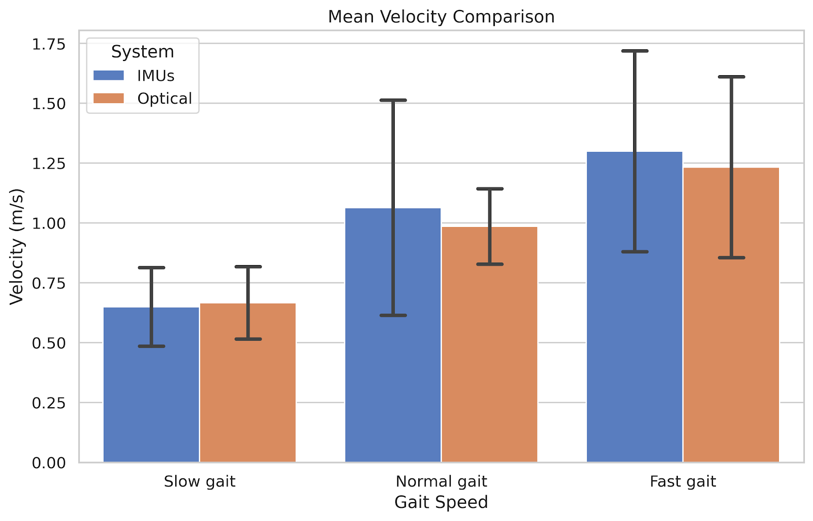
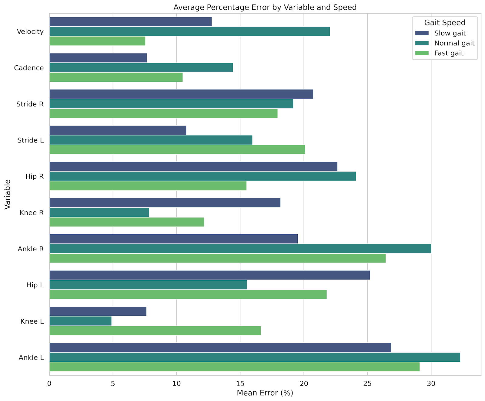

# Gait Analysis

Comparison of inertial and optical motion capture systems during walking.

## Project overview

This group project studied gait in healthy young adults walking at slow,
normal, and fast speeds. The goal was to compare a full-body Xsens IMU system
with a BTS Bioengineering optical motion capture system.

The [final report](docs/final-report.pdf) explains the complete methodology,
data processing, and results. The [initial presentation](docs/initial-presentation.pptx)
summarizes the project goals and workflow.

Personal information about group members and volunteer participants has been
anonymized in the published documentation and local file paths.

## Tools and methods

- Xsens MVN Analyze for inertial motion capture
- BTS SmartClinic and the Helen Hayes protocol for optical motion capture
- MATLAB scripts for gait event detection, parameter extraction, and statistics
- Comparison of velocity, cadence, stride length, and joint angles
- Mean relative difference and coefficient of variation for error and variability

## Main results

- Velocity and cadence showed the closest agreement, especially at slow and
  normal walking speeds.
- Stride length errors were generally between 10% and 20%.
- Knee angles were more consistent than hip and ankle angles.
- Ankle angles showed the highest errors, exceeding 30% in normal gait.
- The IMU system is promising for accessible clinical and rehabilitation
  monitoring, but less suitable for high-precision sports analysis at fast
  speeds.

The study used a small sample of seven participants. Manual synchronization,
marker placement, and outliers affected some comparisons, so the reported
errors should be interpreted as conservative estimates.

## Selected figures





## Repository structure

```text
docs/                 Anonymized report and initial presentation
analysis/scripts/     MATLAB analysis scripts
results-figures/      Aggregate project figures
raw-data/             Local-only participant data (ignored by Git)
analysis/local-results Local-only participant-specific exports (ignored)
```

Raw participant data is kept locally in `raw-data/` for reproducibility but is
not intended for publication.
